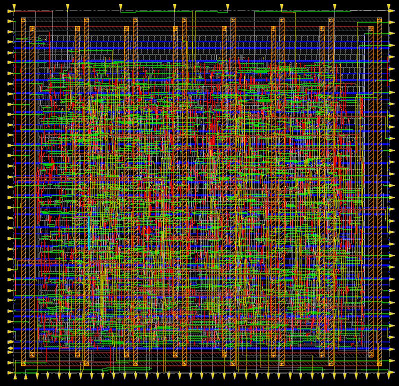

# 2R/1W CPU Register File — RTL to GDSII

Design and full RTL-to-GDSII implementation of an **8 × 32-bit CPU register file** with
**two asynchronous read ports** and **one synchronous write port**, built with the Cadence
digital flow on the **90 nm GPDK (gsclib090)** standard-cell library.

<p align="center">
  
  <br>
  <em>Final routed layout (Cadence Innovus, 90 nm): Metal5/Metal6 power rings and stripes, with I/O pins on all four edges</em>
</p>

---

## Highlights

| Metric | Result |
|---|---|
| Storage | 8 registers × 32 bits = 256 bits |
| Target clock | 100 MHz (10 ns period) |
| Functional verification | 8 / 8 self-checking tests pass |
| Logic equivalence (RTL ↔ netlist) | **PASS** — 320 / 320 points equivalent |
| Post-route setup WNS (slow corner) | **+6.950 ns**, 0 violating paths |
| Post-route hold WNS (fast corner) | **+0.056 ns**, 0 violating paths |
| DRV (max cap / tran / fanout) | 0 violations |
| DRC / connectivity | **No violations** |
| Synthesized cell area | 10 212.85 µm² (873 cells: 256 seq + 617 comb) |
| Final placed & routed area | 10 847.13 µm² (968 instances) |
| Die / core size | 153.41 × 148.19 µm / 133.11 × 127.89 µm |
| Placement density | 63.7 % |
| Total power (post-route, Innovus) | 0.959 mW |
| Final GDSII | Generated by the flow (not distributed, see below) |

---

## Architecture

```
                  write_enable ─┐
   write_addr[2:0] ──► 3:8 write decoder ──► per-register load enable
   write_data[31:0] ────────────┐
                                ▼
                 ┌─────────────────────────────┐
   clk ─────────►│  Register array             │
   rst_n ───────►│  R0 … R7  (8 × 32-bit DFFs) │
                 └──────┬──────────────┬───────┘
                        │              │
   read_addr1[2:0] ──► 8:1 MUX    8:1 MUX ◄── read_addr2[2:0]
                        │              │
                        ▼              ▼
                 read_data1[31:0]  read_data2[31:0]
```

- **Register array** — eight 32-bit registers, each addressed with a 3-bit index.
- **Two read ports** — fully independent combinational (asynchronous) read networks; both
  ports may read the same or different registers in the same cycle.
- **One write port** — the selected register is updated on the rising clock edge only
  when `write_enable` is high; otherwise all contents are retained.
- **Reset** — asynchronous, active-low `rst_n` clears every register to zero, independent
  of the clock.
- **DFT** — Genus inserts a single mux-scan chain (`scan_in` → `scan_out`, shift enable `SE`)
  across all 256 flip-flops.

### Port list

| Port | Dir | Width | Description |
|---|---|---|---|
| `clk` | in | 1 | Clock (writes on rising edge) |
| `rst_n` | in | 1 | Asynchronous active-low reset |
| `write_enable` | in | 1 | Write enable |
| `write_addr` | in | 3 | Write register index |
| `write_data` | in | 32 | Write data |
| `read_addr1` | in | 3 | Read port 1 register index |
| `read_addr2` | in | 3 | Read port 2 register index |
| `read_data1` | out | 32 | Read port 1 data (asynchronous) |
| `read_data2` | out | 32 | Read port 2 data (asynchronous) |
| `SE`, `scan_in`, `scan_out` | in/in/out | 1 | Scan-test ports added during synthesis |

---

## Repository layout

```
.
├── docs/                  Images used in this README
├── 1_design/              RTL and self-checking testbench
│   ├── reg_file_2r1w.v
│   └── reg_file_2r1w_tb.v
├── 3_synthesis/           Genus synthesis + DFT scan insertion
│   ├── reg_file_synth_dft.tcl          synthesis script
│   ├── reg_file_sdc.g                  input timing constraints (SDC)
│   ├── reg_file_2r1w_netlist_dft.v     gate-level netlist (with scan)
│   ├── reg_file_2r1w_generated_*.g/.sdf  generated SDC and SDF
│   ├── reg_file_2r1w_scanDEF.scandef   scan-chain DEF
│   └── reports/                        area, timing, power, QoR, scan chains
├── 4_lec/                 Conformal logic equivalence check (RTL vs netlist)
├── 5_tempus/              Tempus signoff STA script and reports
└── 6_physical_design/     Innovus floorplan → GDSII
    ├── innovus_flow.tcl                complete PnR flow script
    ├── reports/                        final area/power/timing/DRC/connectivity
    ├── timingReports/                  pre-CTS, post-CTS, post-route timing
    ├── checkDesign/                    netlist & placement checks
    └── outputs/
        └── reg_file_2r1w_routed.v      post-route netlist
```

---

## Implementation flow

| # | Stage | Tool | Files |
|---|---|---|---|
| 1 | RTL design | Verilog-2001 | `1_design/reg_file_2r1w.v` |
| 2 | Functional verification | Cadence Xcelium | `1_design/reg_file_2r1w_tb.v` |
| 3 | Logic synthesis + DFT | Cadence Genus 21.14 | `3_synthesis/` |
| 4 | Logic equivalence check | Cadence Conformal LEC 21.10 | `4_lec/` |
| 5 | Signoff STA (gate level) | Cadence Tempus 22.11 | `5_tempus/` |
| 6 | Floorplan & pin placement | Cadence Innovus 21.15 | `innovus_flow.tcl` → `floorplan` |
| 7 | Power planning | Innovus | `power_plan` |
| 8 | Placement + pre-CTS opt | Innovus | `placement` |
| 9 | Clock tree synthesis | Innovus CCOpt | `cts` |
| 10 | Routing | Innovus NanoRoute | `routing`, `post_route` |
| 11 | Physical verification & GDSII | Innovus | `final` |

### 1–2 · RTL and verification

The testbench (`reg_file_2r1w_tb.v`) runs a 100 MHz clock and self-checks every case:

1. Asynchronous reset clears all registers
2. Sequential synchronous writes (R1, R2) — checked in test 3
3. Dual simultaneous reads from different registers
4. Both ports reading the same register
5. Read on two registers while writing a third
6. Committed write data is read back correctly
7. Data retention when `write_enable` is low
8. Asynchronous reset asserted mid-operation

```
xrun 1_design/reg_file_2r1w.v 1_design/reg_file_2r1w_tb.v -access +rwc
```

### 3 · Synthesis (Genus)

- Library: `slow.lib` (gsclib090), high effort generic/map/opt
- Constraints (`reg_file_sdc.g`): 10 ns clock, 0.1 ns clock transition, 1.0 ns input/output
  delay, false path from `rst_n`
- Mux-scan DFT: one chain through all 256 flops
- Result: 873 cells, 10 212.85 µm², worst slack +8.41 ns, synthesis power 0.762 mW
  (84 % in registers)

```
cd 3_synthesis && genus -f reg_file_synth_dft.tcl
```

### 4 · Logic equivalence (Conformal)

RTL (golden) vs. scan-inserted netlist (revised), with `SE` tied to 0 and scan ports ignored.
All 64 primary outputs and 256 DFFs map and compare **equivalent — PASS**.

```
cd 4_lec
lec -XL -nogui -dofile lib_v.do        # generates a Verilog model of slow.lib
lec -XL -nogui -dofile reg_file_lec.do
```

### 5 · Signoff STA (Tempus)

Gate-level STA with the Genus SDF/SDC, functional mode (`SE = 0`). All external-delay,
setup and hold checks that are exercised are met with zero violations.

```
cd 5_tempus && tempus -files tempus_signoff.tcl
```

### 6–11 · Physical design (Innovus)

- **Floorplan:** aspect ratio 1, 60 % target utilisation, 10 µm core margin.
  Pins are grouped by function: write port on the west edge (Metal3), clock/reset/read
  addresses on the north (Metal4), `read_data1` on the east (Metal3), `read_data2` and scan
  pins on the south (Metal4).
- **Power:** VDD/VSS core rings on Metal5/Metal6 and vertical Metal6 stripes every 20 µm,
  leaving lower metals free for signal routing; `sroute` drops followpins to the rings.
- **Placement:** timing-driven placement with pre-CTS setup/hold analysis.
- **CTS:** CCOpt with `CLKBUFX2/4/8`, 250 ps max transition, clock routed on Metal5–6,
  then post-CTS hold fixing (target slack 50 ps).
- **Routing:** NanoRoute global + detail on Metal1–Metal9, post-route wire/via
  optimisation, OCV analysis with CPPR and post-route hold fixing.
- **Signoff:** filler insertion, `verify_drc`, `verify_connectivity`, GDSII streamout merged
  with the gsclib090 cell layouts.

MMMC views: `slow_view` (setup), `fast_view` (hold), `typical_view`.

```
cd 6_physical_design && innovus -files innovus_flow.tcl
```

`innovus_flow.tcl` defines one procedure per stage (`init_design_flow`, `floorplan`,
`power_plan`, `placement`, `cts`, `routing`, `post_route`, `final`) and saves a checkpoint
after each; uncomment the calls at the bottom of the script to run the stages you need.

#### Post-route timing

| | all | reg2reg | default |
|---|---|---|---|
| Setup WNS (ns) | 6.950 | 9.312 | 6.950 |
| Hold WNS (ns) | 0.056 | 0.080 | 0.056 |
| TNS / violating paths | 0 / 0 | 0 / 0 | 0 / 0 |

Critical setup path: `read_addr1[1]` → INVXL → CLKAND2X2 → AOI22X1 → NAND4XL →
`read_data1[1]` (2.05 ns through the read mux, against a 9.0 ns budget).

#### Post-route power (slow corner, 0.9 V)

| Group | Internal | Switching | Leakage | Total | % |
|---|---|---|---|---|---|
| Sequential | 0.630 | 0.030 | 0.039 | 0.699 mW | 72.9 |
| Combinational | 0.079 | 0.075 | 0.025 | 0.179 mW | 18.7 |
| Clock | 0.022 | 0.058 | 0.001 | 0.081 mW | 8.4 |
| **Total** | **0.731** | **0.163** | **0.065** | **0.959 mW** | 100 |

---

## Reproducing the flow

The scripts expect the Cadence GPDK 90 nm (`gsclib090`) collateral, which is **not
included** in this repository because it is licensed foundry data. Before running:

- Copy `slow.lib`, `typical.lib` and `fast.lib` into `3_synthesis/lib/`.
- Copy the library GDS to `6_physical_design/gds_lib/gsclib090.gds` (or let the script
  fall back to the install path).
- Update the LEF paths in `init_design_flow` of `innovus_flow.tcl` to match your install.

Innovus checkpoint databases (`*.dat`) are also excluded; they are regenerated by running
the flow.

The final GDSII (`6_physical_design/outputs/reg_file_2r1w.gds`) is **not distributed**
either: it is streamed out merged with the `gsclib090` cell layouts, so it contains licensed
library data. Running the `final` stage of `innovus_flow.tcl` regenerates it.

---

## License

The RTL, testbench, scripts, reports and documentation in this repository are released
under the [MIT License](LICENSE). The license does not cover the Cadence tools or the
GPDK 90 nm (`gsclib090`) library, which are licensed separately and are not included.

---
